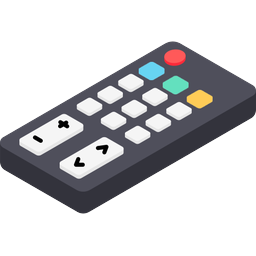
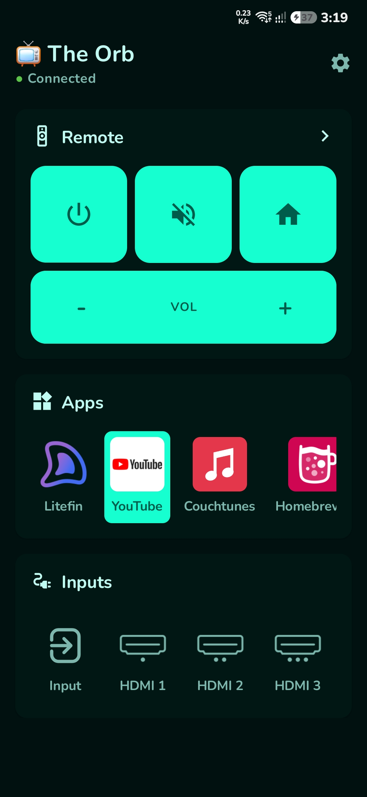
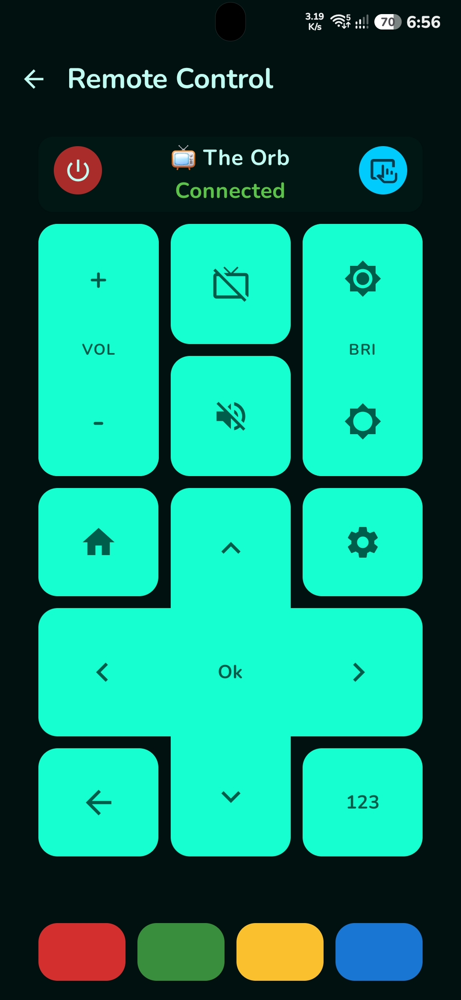
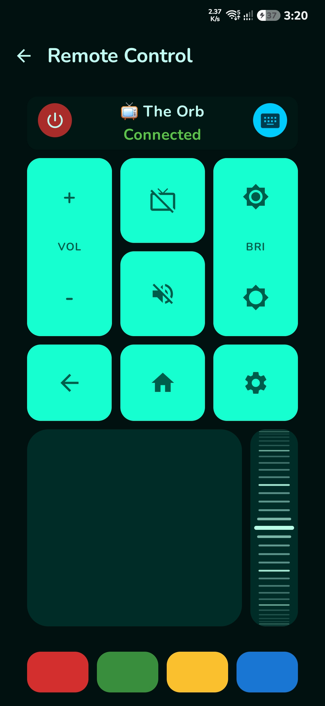
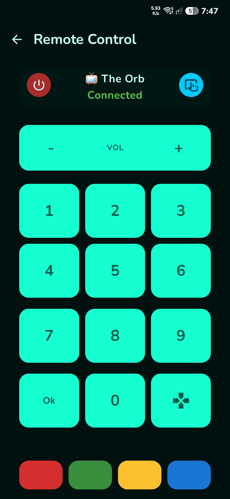
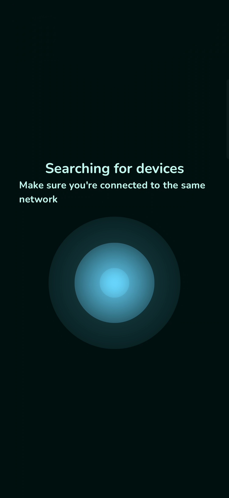
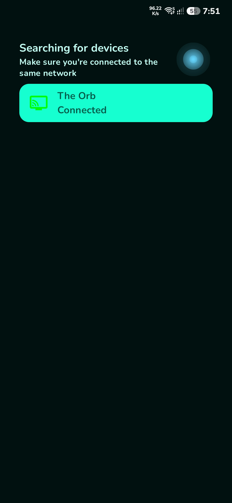
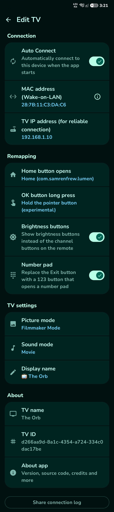

  

<h2 align="center">LG TV Controller</h2>

  

An ad free android app to control your LG television.

I started this project because the only apps I could find to control my tv were full of ads and 
therefore unusable, so I decided to make an add free one that I could use without stress.

### Screenshots

| Home | Remote | Touch Pad | Numbers |
|---|---|---|---|
|  |  |  |  |

 | Searching | Device List | Settings |
|---|---|---|
|  |  |  |

### Credits
* [LGPower](https://github.com/Nicsilver/LGPower/)
* App icon based on the [remote control icon](https://www.flaticon.com/free-icon/remote-control_18091280)
  by [cah nggunung](https://www.flaticon.com/authors/cah-nggunung) from [Flaticon](https://www.flaticon.com/),
  edited for this app. Icons created by cah nggunung - Flaticon.
